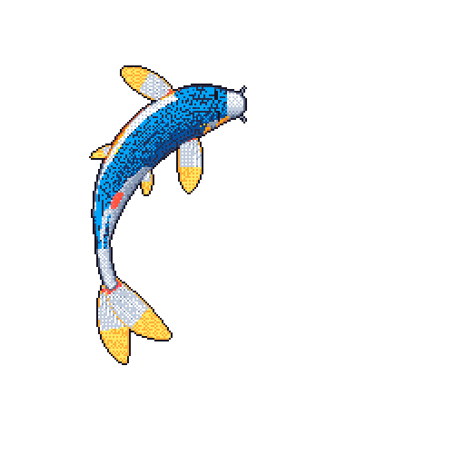

<!-- SWARM:START (generated by readme-swarm, edit swarm.config.json instead) -->
<table>
<tr>
<td width="50%" valign="top"></td>
<td valign="top"> <a href="#swarm"><picture><source media="(prefers-color-scheme: dark)" srcset="./assets/swarm/about-dark.svg?v=869eafc0" /><source media="(prefers-color-scheme: light)" srcset="./assets/swarm/about-light.svg?v=869eafc0" /></picture></a> <a href="#swarm"><picture><source media="(prefers-color-scheme: dark)" srcset="./assets/swarm/building-dark.svg?v=aae4d227" /><source media="(prefers-color-scheme: light)" srcset="./assets/swarm/building-light.svg?v=aae4d227" /></picture></a> <a href="#swarm"><picture><source media="(prefers-color-scheme: dark)" srcset="./assets/swarm/project-1-dark.svg?v=ec0c1cb3" /><source media="(prefers-color-scheme: light)" srcset="./assets/swarm/project-1-light.svg?v=ec0c1cb3" /></picture></a> <a href="https://github.com/tinyfish-io/tinyfish-cookbook"><picture><source media="(prefers-color-scheme: dark)" srcset="./assets/swarm/project-2-dark.svg?v=cfc664e4" /><source media="(prefers-color-scheme: light)" srcset="./assets/swarm/project-2-light.svg?v=cfc664e4" /></picture></a> <a href="https://github.com/openclaw/openclaw/pull/58645"><picture><source media="(prefers-color-scheme: dark)" srcset="./assets/swarm/project-3-dark.svg?v=df4ecd36" /><source media="(prefers-color-scheme: light)" srcset="./assets/swarm/project-3-light.svg?v=df4ecd36" /></picture></a> <a href="https://github.com/giaphutran12/rustify"><picture><source media="(prefers-color-scheme: dark)" srcset="./assets/swarm/project-4-dark.svg?v=87898f0a" /><source media="(prefers-color-scheme: light)" srcset="./assets/swarm/project-4-light.svg?v=87898f0a" /></picture></a> <a href="#swarm"><picture><source media="(prefers-color-scheme: dark)" srcset="./assets/swarm/project-5-dark.svg?v=528d6a66" /><source media="(prefers-color-scheme: light)" srcset="./assets/swarm/project-5-light.svg?v=528d6a66" /></picture></a> <a href="https://github.com/giaphutran12/Whiteboard"><picture><source media="(prefers-color-scheme: dark)" srcset="./assets/swarm/project-6-dark.svg?v=4774f945" /><source media="(prefers-color-scheme: light)" srcset="./assets/swarm/project-6-light.svg?v=4774f945" /></picture></a> <a href="#swarm"><picture><source media="(prefers-color-scheme: dark)" srcset="./assets/swarm/toolkit-dark.svg?v=2740c182" /><source media="(prefers-color-scheme: light)" srcset="./assets/swarm/toolkit-light.svg?v=2740c182" /></picture></a></td>
</tr>
</table>

<!-- SWARM:END -->

## Tower

The thing I'm proudest of. Tower is the operating system Build Launch Iterate
runs on: tickets, docs, chat, mail, calendar, meeting notes, and an assistant
called JARVIS, all on one backend. Every feature works from the web app, a
command line, and Slack, and the same endpoints are exposed as MCP tools, so our
coding agents work inside Tower next to the people.

- A collector on every teammate's machine, macOS and Windows, picks up Codex and
  Claude Code sessions, masks secrets before anything leaves the laptop, and
  feeds an LLM judge that turns the sessions into coaching for our interns.
- 2,700+ merged pull requests and 470 database migrations since April 2026.
  About 2,500 of the ~3,000 commits are mine, most of them written by agents I
  run.
- 300+ MCP tools, and a [CLI on npm](https://www.npmjs.com/package/@bli-cockpit/cli)
  on its 291st release.
- Next.js, Postgres on Supabase with row-level security, the AI SDK, Mastra, and
  Railway.

The code is private, so there's nothing to click. I'm happy to demo it.

  

## Recently shipped

<!-- recently_shipped starts -->
- [rules: raw SQL at the call site, no wrappers (one RLS helper excepted)](https://github.com/giaphutran12/edward-agent-stack/pull/24) in `giaphutran12/edward-agent-stack`, 2026-10-09
- [Give players three business decisions to start with](https://github.com/giaphutran12/empirio-clone/pull/1) in `giaphutran12/empirio-clone`, 2026-09-22
- [feat(mythos): list RizzCode on the Mythos marketplace](https://github.com/giaphutran12/rizzcode/pull/26) in `giaphutran12/rizzcode`, 2026-09-20
- [Speed demo video on slide 5 up to 2x (54s)](https://github.com/Catnip-harvest/Mira-on-Uno-Q/pull/5) in `Catnip-harvest/Mira-on-Uno-Q`, 2026-08-16
- [Preserve all board calibration snapshots; restore afternoon LKG leader calibration](https://github.com/fountainhead-2207/Qualcom_Mira/pull/4) in `fountainhead-2207/Qualcom_Mira`, 2026-08-15
- [Add Trump longitudinal evidence v1](https://github.com/giaphutran12/predict-trump/pull/4) in `giaphutran12/predict-trump`, 2026-08-12
<!-- recently_shipped ends -->

Refreshed every night from my public merged pull requests.

---

[edwardtran.ca](https://edwardtran.ca) · [LinkedIn](https://linkedin.com/in/edwardtran123) · [Email](mailto:giaphutran012@gmail.com)
